# PHP Arrays and Functions Practices

This README contains PHP practices covering arrays and functions.

---

# Practice #1: Two-Dimensional Array

## Screenshot Name

`PHP_2D_Array.png`

## Description

This practice demonstrates how to create and display a two-dimensional array using nested `foreach` loops.

```php
$numbers = array(
    array(1, 2, 3),
    array(4, 5, 6),
    array(7, 8, 9)
);

foreach ($numbers as $row) {
    foreach ($row as $n)
        echo "$n <br>";
}
```

### Output

```text
1
2
3
4
5
6
7
8
9
```

## Screenshot

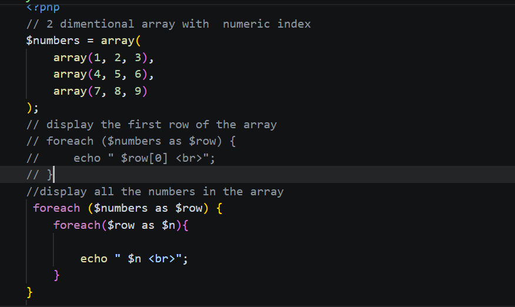

---

# Practice #2: is_array() Function

## Screenshot Name

`PHP_Is_Array.png`

## Description

Checks whether a variable is an array.

```php
if (is_array($info))
    echo "Is Array";
else
    echo "Is not Array";
```

### Output

```text
Is Array
```

## Screenshot

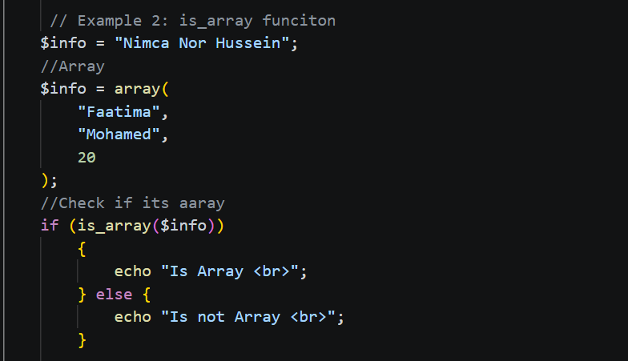

---

# Practice #3: in_array() Function

## Screenshot Name

`PHP_In_Array.png`

## Description

Checks whether a value exists inside an array.

```php
if (in_array(30, $info))
    echo "Found";
else
    echo "Not Found";
```

### Output

```text
Not Found
```

## Screenshot

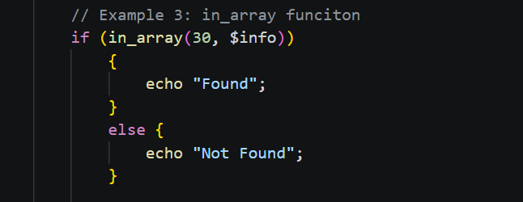

---

# Practice #4: count() Function

## Screenshot Name

`PHP_Count_Array.png`

## Description

Counts the number of elements in an array.

```php
$arrays = array(
    array(90, "Abukar", "Ibrahim"),
    array(80, "Omar", "Ibrahim")
);

echo "Size: " . count($arrays);
```

### Output

```text
Size: 2
```

## Screenshot

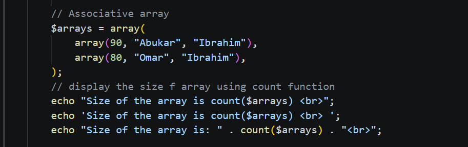

---

# Practice #5: explode() and shuffle()

## Screenshot Name

`PHP_Explode_Shuffle.png`

## Description

`explode()` converts a string into an array, while `shuffle()` randomly changes the order.

```php
$a = "The quick brown fox jumps over the lazy dog";
$b = explode(" ", $a);
shuffle($b);

print_r($b);
```

## Screenshot

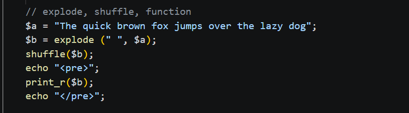

---

# Practice #6: array_merge()

## Screenshot Name

`PHP_Array_Merge.png`

## Description

Combines two arrays into one array.

```php
$a1 = array(1, 2, 3);
$a2 = array(1, 5, 6);

$a3 = array_merge($a1, $a2);
print_r($a3);
```

### Output

```text
1 2 3 1 5 6
```

## Screenshot

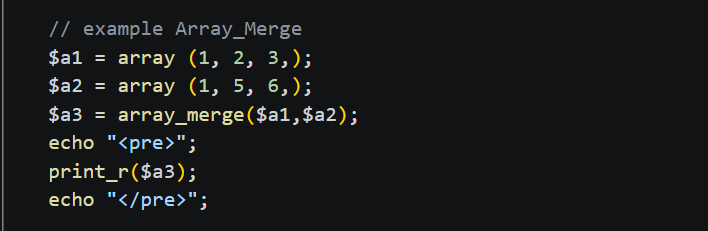

---

# Practice #7: array_reverse()

## Screenshot Name

`PHP_Array_Reverse.png`

## Description

Reverses the order of an array.

```php
$p = array_reverse($a3);
```

## Screenshot

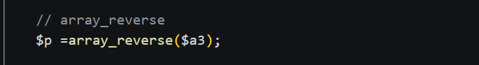

---

# Practice #8: array_push()

## Screenshot Name

`PHP_Array_Push.png`

## Description

Adds a new element to the end of an array.

```php
$a = array(2, 4, 6, 8);
array_push($a, 10);
print_r($a);
```

### Output

```text
2 4 6 8 10
```

## Screenshot

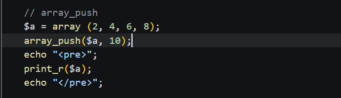

---

# Practice #9: array_pop()

## Screenshot Name

`PHP_Array_Pop.png`

## Description

Removes the last element from an array.

```php
$a = array(1, 2, 3, 4);
array_pop($a);
print_r($a);
```

### Output

```text
1 2 3
```

## Screenshot

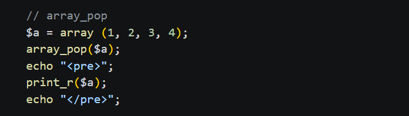

---

# Practice #10: end() Function

## Screenshot Name

`PHP_End_Function.png`

## Description

Gets the last element of an array.

```php
$last = end($a);
echo "The last element is: " . $last;
```

### Output

```text
The last element is: 3
```

## Screenshot

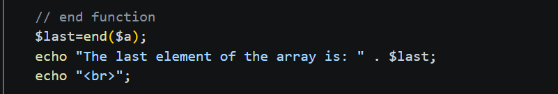

---

# Practice #11: Creating a Function

## Screenshot Name

`PHP_Create_Function.png`

## Description

Demonstrates how to create and call a function.

```php
function writeMsg() {
    echo "Hello world!";
}

writeMsg();
```

### Output

```text
Hello world!
```

## Screenshot

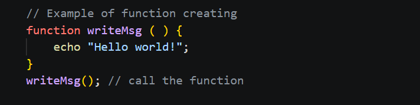

---

# Practice #12: Factorial Function

## Screenshot Name

`PHP_Factorial_Function.png`

## Description

Calculates the factorial of a number using a function and `for` loop.

```php
function factorial($a) {
    $result = 1;

    for ($i = 1; $i <= $a; $i++)
        $result *= $i;

    echo "Factorial of $a is: $result";
}

factorial(5);
```

### Output

```text
Factorial of 5 is: 120
```

## Screenshot

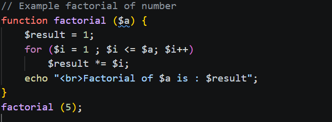

---

# Summary

This file demonstrates PHP:

* Two-dimensional arrays
* Array checking and searching
* Array counting
* Array manipulation
* Functions
* Factorial calculation
